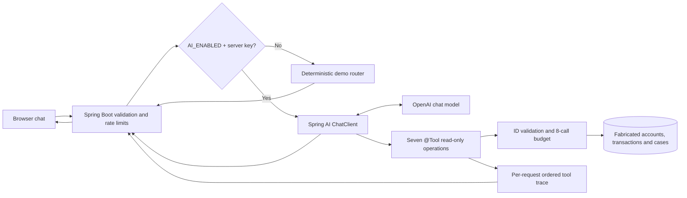

# Architecture



## Security boundaries

1. Backend blocks write requests before reaching the model. Only read tool methods are registered. There are no state-changing backend routes.
2. Model input is untrusted. Tool arguments are strictly validated server-side as synthetic IDs. Tool responses contain fabricated records and must not be treated as instructions.
3. Each HTTP call creates a new `BankingReadTools` instance. Its ordered trace and 8-call ceiling cannot leak into another request.
4. Model access is disabled unless `AI_ENABLED=true` and `OPENAI_API_KEY` is configured on the server. Requests are subject to both IP rate limiting and a global daily/minute quota.
5. Provider errors return a sanitized 502 response. They are **not** silently replaced by fake AI answers.
6. Only a deliberately configured hosted model call can incur API costs. Local fallback tests use no provider key.

## Example AI investigation

```text
Question: Investigate TX-2002 and its linked case
  model selects lookupTransaction("TX-2002")
  model may select lookupAccount("ACC-1001")
  model may select casesForTransaction("TX-2002")
  model explains returned evidence, with IDs
Response: mode=spring-ai-tool-calling, answer, ordered tool trace
```

Actual tool selection varies by model and prompt, unlike the fixed deterministic fallback. A transaction status of "Review required" does not establish a fraud cause.
