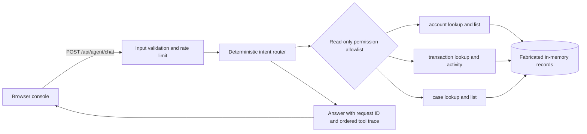

# Architecture



## Trust boundaries

- The browser is untrusted. Inputs are validated by the Java backend.
- Tool names and permissions are chosen server-side from a fixed read-only allowlist.
- Every tool call emits a trace entry with the input, outcome and permission.
- No tool writes data. There is no transfer or case creation endpoint.
- There is no LLM, Spring AI or MCP integration yet. The router is deterministic.
- Requests are limited to 40 per remote IP per minute in memory. This is not a production distributed quota.
- All data is fabricated and is never persisted.

## Investigation example

```text
Investigate TX-2002
  transaction.lookup(TX-2002) [read:transactions]
  account.lookup(ACC-1001) [read:accounts]
  case.by_transaction(TX-2002) [read:cases]
  -> transaction summary, linked account, case and evidence limitations
```

A review status in the synthetic record is not evidence of fraud. The agent explains when it cannot determine a cause.